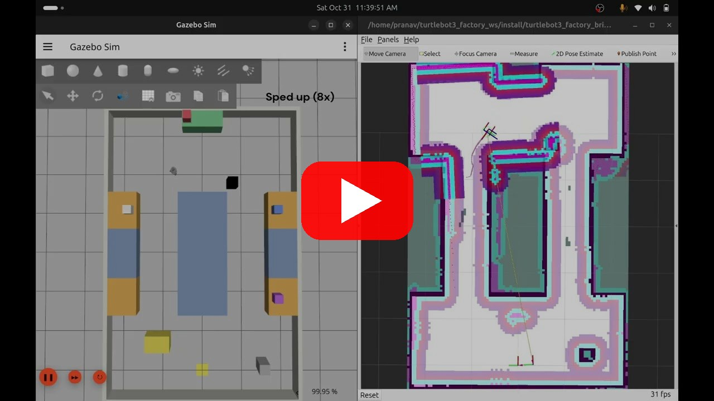
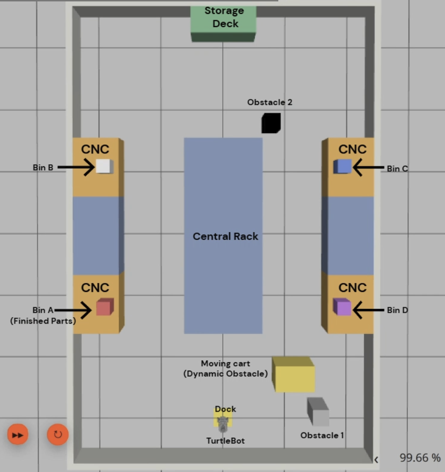

# TurtleBot3 Factory Autonomous Navigation
Autonomous navigation of a TurtleBot3 Burger in Gazebo Harmonic with the ROS 2 Jazzy Nav2 stack. The robot drives to a sequence of goals on a pre-built map while avoiding static obstacles (racks, machines, pillars) and a moving pallet cart.

This project is modelled after material-movement task like the one shown in Antropi
Robotics' video: a mobile robot collects full finished-parts boxes from CNC
machines and takes them to a storage rack, so the machines don't wait.

Four simulated CNC stations fill their boxes over time and request a pickup
when full. A dispatcher queues the requests first come, first served and sends
a TurtleBot3 Burger to each station with Nav2, then to storage, and back to the
dock when the queue is empty. A pallet cart moves through the area as a dynamic
obstacle. Pickup is simulated and the box is removed from the machine and spawned
on the storage rack in Gazebo.

## Demo

[](https://youtu.be/DCC3VNYN0Us)

▶ [Watch the demo on YouTube](https://youtu.be/DCC3VNYN0Us) (Gazebo and RViz). Watch in 1080p. Long drives are sped up and labelled in the video.

## World layout

<p align="center">
  
</p>

- Dock (robot start) at the bottom, storage deck at the top
- Four CNC machines A–D along two 1 m aisles, each with a coloured finished-parts box (A red, B light grey, C blue, D purple)
- Central rack between the aisles, two pillars as static obstacles
- Yellow pallet cart moving across the dock zone as a dynamic obstacle

## Navigation stack
Stock ROS 2 packages, configured for this world; no custom navigation algorithms.

- **Mapping:** slam_toolbox (online async) built the map once and the map is saved in `turtlebot3_factory_bringup/maps/`.
- **Localization:** AMCL on that map.
- **Global planner:** NavFn, replanning at 4 Hz (copy of the stock Nav2 behaviour tree with a faster replan rate).
- **Local controller:** DWB, max speed 0.22 m/s.
- **Obstacle avoidance:** global and local costmaps with obstacle, voxel and inflation layers fed by the 2D lidar; the moving cart is not in the map and is seen only by the lidar. Collision monitor stops the robot if anything comes within 0.15 m of its centre.
- **Goals:** sent by the task dispatcher through `nav2_simple_commander` (`goToPose`) and they can also be sent by hand with Nav2 Goal in RViz.
- **Base config:** `nav2_params.yaml` starts from the TurtleBot3 Burger defaults and the changes are listed at the top of the file.

## Requirements
Ubuntu 24.04, ROS 2 Jazzy, Gazebo Harmonic

## Build
Create Workspace:
```bash
mkdir -p ~/factory_ws/src && cd ~/factory_ws/src
```

Clone repo:
```bash
git clone https://github.com/ppranav04/turtlebot3_factory_nav.git
```

Install dependencies and source:
```bash
source /opt/ros/jazzy/setup.bash
cd ~/factory_ws
rosdep install --from-paths src --ignore-src -r -y
colcon build --symlink-install
source install/setup.bash
```

## Run
Terminal 1: Simulation, Nav2 and RViz
```bash
source /opt/ros/jazzy/setup.bash && source ~/factory_ws/install/setup.bash
ros2 launch turtlebot3_factory_bringup factory_sim.launch.py
```

Terminal 2: Once RViz shows the map and Terminal 1 logs "Managed nodes are active", start the stations and dispatcher:
```bash
source /opt/ros/jazzy/setup.bash && source ~/factory_ws/install/setup.bash
ros2 launch turtlebot3_factory_bringup workflow.launch.py
```
